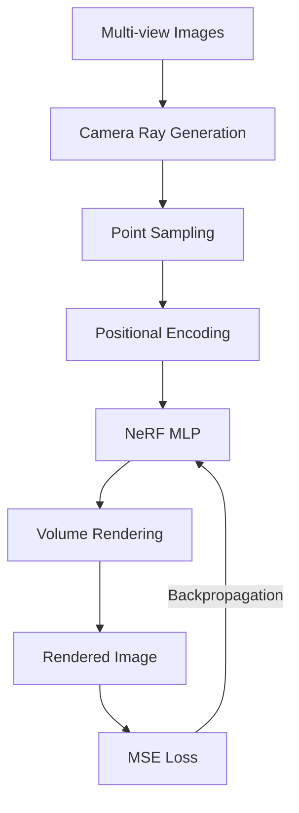

# PyTorch NeRF – Neural Radiance Fields for 3D Scene Reconstruction

<p align="center">
  
  
  
  
  
</p>

A modular, readable, and production-oriented implementation of **Neural Radiance Fields (NeRF)** using PyTorch, developed from first principles and based on the seminal research paper:

> **NeRF: Representing Scenes as Neural Radiance Fields for View Synthesis**  
> Ben Mildenhall, Pratul P. Srinivasan, Matthew Tancik, Jonathan T. Barron, Ravi Ramamoorthi, and Ren Ng  
> ECCV 2020 – Best Paper Honorable Mention  
>
> [Research Paper](https://arxiv.org/abs/2003.08934) | [Official Project Website](https://www.matthewtancik.com/nerf)

---

## Table of Contents

- [Project Introduction](#project-introduction)
- [Research Motivation](#research-motivation)
- [Methodology Overview](#methodology-overview)
- [System Architecture](#system-architecture)
- [Mathematical Formulation](#mathematical-formulation)
  - [Continuous Volume Rendering](#continuous-volume-rendering)
  - [Transmittance Formulation](#transmittance-formulation)
  - [Discrete Approximation and Alpha Compositing](#discrete-approximation-and-alpha-compositing)
- [Camera Geometry](#camera-geometry)
- [Positional Encoding](#positional-encoding)
- [Dataset](#dataset)
- [Installation](#installation)
- [Hardware Requirements](#hardware-requirements)
- [Quick Start](#quick-start)
- [Training](#training)
- [Evaluation](#evaluation)
- [Rendering and Novel View Synthesis](#rendering-and-novel-view-synthesis)
- [Project Structure](#project-structure)
- [Experiment Results](#experiment-results)
- [Limitations](#limitations)
- [Future Directions](#future-directions)
- [References](#references)
- [License](#license)

---

## Project Introduction

This repository provides an end-to-end PyTorch implementation of Neural Radiance Fields for photorealistic novel view synthesis and 3D scene reconstruction.

Unlike conventional discrete 3D representations such as polygon meshes, point clouds, and voxel grids, NeRF represents a continuous 3D scene as an **implicit neural function** modeled by a multi-layer perceptron (MLP):

\[
F_\Theta:(\mathbf{x},\mathbf{d})\mapsto(\mathbf{c},\sigma)
\]

Where:

- \(\mathbf{x}=(x,y,z)\): 3D spatial coordinates.
- \(\mathbf{d}=(\theta,\phi)\): Viewing direction represented by a unit vector in \(\mathbb{R}^3\).
- \(\mathbf{c}=(r,g,b)\): Emitted RGB radiance.
- \(\sigma\in[0,\infty)\): Differential volume density.

By combining coordinate-based neural representations with differentiable volume rendering, the model learns a 3D scene from calibrated 2D images using gradient descent, without requiring explicit 3D supervision or ground-truth geometry.

---

## Research Motivation

Reconstructing photorealistic 3D representations from collections of 2D photographs is a fundamental problem in computer vision and computer graphics.

Traditional approaches have several limitations:

1. **Voxel Grids:** Discretize 3D space into cubic cells. Memory consumption scales cubically with spatial resolution, limiting reconstruction quality.
2. **Point Clouds:** Represent geometry as discrete points without continuous surface connectivity, making realistic rendering and occlusion modeling more challenging.
3. **Polygon Meshes:** Provide efficient rendering but make optimization from multi-view images difficult, particularly for complex structures, transparency, and specular reflections.

NeRF addresses these limitations by representing the entire scene as a continuous mathematical field parameterized by neural network weights.

### Key Advantages

- **Resolution Independence:** Continuous scene representation enables rendering at different target resolutions.
- **Topology Agnostic:** Supports complex geometry, including hair, foliage, and intricate structures.
- **View-Dependent Appearance:** Models directional reflections and appearance variations.
- **Differentiable Rendering:** Enables direct optimization from image observations using photometric loss.

---

## Methodology Overview

The NeRF pipeline consists of seven major stages:

1. **Camera Ray Generation:** Camera intrinsics and extrinsics are used to generate rays through image pixels.
2. **Stratified Sampling:** Sample points are distributed along each ray between near and far clipping planes.
3. **Positional Encoding:** Spatial coordinates and viewing directions are transformed into higher-dimensional Fourier features.
4. **NeRF MLP Evaluation:** An eight-layer MLP predicts volume density and directional RGB color.
5. **Volume Rendering:** Sampled colors and densities are combined using differentiable alpha compositing.
6. **Loss Computation:** Rendered pixel colors are compared with ground-truth pixels using Mean Squared Error (MSE).
7. **Backpropagation:** Gradients are propagated through the rendering process to optimize network parameters.

---

## System Architecture



---

## Mathematical Formulation

### Continuous Volume Rendering

For a camera ray:

\[
\mathbf{r}(t)=\mathbf{o}+t\mathbf{d}
\]

The expected color along the ray is calculated using:

\[
C(\mathbf{r})=
\int_{t_n}^{t_f}
T(t)\sigma(\mathbf{r}(t))
\mathbf{c}(\mathbf{r}(t),\mathbf{d})\,dt
\]

Where:

- \(\sigma(\mathbf{r}(t))\): Volume density.
- \(\mathbf{c}(\mathbf{r}(t),\mathbf{d})\): Directional RGB radiance.
- \(T(t)\): Accumulated transmittance.
- \(t_n,t_f\): Near and far ray bounds.

### Transmittance Formulation

Transmittance represents the probability that a ray travels from the near plane to a particular point without being obstructed.

\[
T(t)=
\exp\left(
-\int_{t_n}^{t}
\sigma(\mathbf{r}(s))\,ds
\right)
\]

Properties:

- \(T(t_n)=1\): Complete visibility at the near plane.
- Transmittance monotonically decreases or remains constant along the ray.
- Dense regions reduce transmittance, naturally modeling occlusion.

### Discrete Approximation and Alpha Compositing

The continuous rendering integral is approximated using numerical quadrature over sampled intervals:

\[
\hat C(\mathbf{r})=
\sum_{i=1}^{N}
T_i
\left(1-\exp(-\sigma_i\delta_i)\right)
\mathbf{c}_i
\]

Where:

- \(\delta_i=t_{i+1}-t_i\): Distance between adjacent samples.
- \(\sigma_i\): Volume density at sample \(i\).
- \(\mathbf{c}_i\): Predicted RGB color.
- \(\alpha_i=1-\exp(-\sigma_i\delta_i)\): Sample opacity.
- \(T_i\): Accumulated transmittance.

The discrete transmittance is:

\[
T_i=
\exp\left(
-\sum_{j=1}^{i-1}\sigma_j\delta_j
\right)
=
\prod_{j=1}^{i-1}(1-\alpha_j)
\]

For a specified background color:

\[
\hat C_{\text{final}}(\mathbf{r})=
\hat C(\mathbf{r})+
(1-\text{Opacity}(\mathbf{r}))\mathbf{c}_{bg}
\]

Where:

\[
\text{Opacity}(\mathbf{r})=
\sum_{i=1}^{N}T_i\alpha_i
\]

---

## Camera Geometry

This implementation follows the standard **OpenGL / NeRF camera convention**:

| Axis | Direction |
|---|---|
| +X | Right |
| +Y | Up |
| +Z | Backward, away from the scene |
| -Z | Camera viewing direction |

### Ray Generation

For an image with dimensions \(H\times W\) and focal length \(f\), each pixel generates a camera-space direction:

\[
x_c=\frac{i-c_x}{f}
\]

\[
y_c=-\frac{j-c_y}{f}
\]

\[
z_c=-1
\]

Using the camera-to-world transformation matrix:

\[
\begin{bmatrix}
R & \mathbf{t}\\
\mathbf{0}^T & 1
\end{bmatrix}
\]

The ray origin and normalized world-space direction are:

\[
\mathbf{o}=\mathbf{t}
\]

\[
\mathbf{d}=
\frac{R[x_c,y_c,z_c]^T}
{\|R[x_c,y_c,z_c]^T\|_2}
\]

---

## Positional Encoding

Neural networks exhibit **spectral bias**, meaning they tend to learn low-frequency functions more easily than high-frequency details.

Passing raw spatial coordinates directly into an MLP can result in oversmoothed reconstructions.

NeRF addresses this through Fourier-based positional encoding:

\[
\gamma(p)=
\left(
\sin(2^0\pi p),\cos(2^0\pi p),
\dots,
\sin(2^{L-1}\pi p),\cos(2^{L-1}\pi p)
\right)
\]

### Encoding Configuration

| Input | Frequency Octaves | Encoded Dimension |
|---|---:|---:|
| Spatial Position | 10 | 63 |
| Viewing Direction | 4 | 27 |

This enables the network to represent high-frequency geometric details and complex visual patterns.

---

## Dataset

The implementation supports the canonical **NeRF Synthetic Blender Dataset**, introduced in the original NeRF paper.

It contains eight synthetic 360-degree scenes:

- Chair
- Drums
- Ficus
- Hotdog
- Lego
- Materials
- Mic
- Ship

Each scene contains images rendered at \(800\times800\) resolution with corresponding ground-truth camera poses.

### Download Instructions

Download the dataset using Google Drive or the automated helper script:

```bash
python scripts/download_data.py --scene lego --out_dir data/
```

### Expected Directory Structure

```text
data/
└── lego/
    ├── transforms_train.json
    ├── transforms_val.json
    ├── transforms_test.json
    ├── train/
    │   ├── r_0.png
    │   └── ...
    ├── val/
    │   ├── r_0.png
    │   └── ...
    └── test/
        ├── r_0.png
        └── ...
```

---

## Installation

### Prerequisites

- Python 3.10, 3.11, or 3.12
- PyTorch 2.0+
- pip
- Virtual environment or Conda

### Setup

**1. Clone the repository**

```bash
git clone https://github.com/your-username/pytorch-nerf-3d-reconstruction.git

cd pytorch-nerf-3d-reconstruction
```

**2. Create a virtual environment**

```bash
python -m venv venv
```

**3. Activate the environment**

Linux/macOS:

```bash
source venv/bin/activate
```

Windows:

```bash
venv\Scripts\activate
```

**4. Install dependencies**

```bash
pip install -r requirements.txt
```

---

## Hardware Requirements

The following configurations are the project's estimated hardware benchmarks.

| Configuration | Resolution | Batch Size | Estimated Training Time | Use Case |
|---|---|---:|---|---|
| CPU Only | 100 × 100 | 1,024 rays | 8–16 hours | Unit tests and pipeline validation |
| RTX 3060/4060 | 400 × 400 | 2,048 rays | 2.5–4 hours | Experiments and reconstruction |
| RTX 3090/4090/A100 | 800 × 800 | 4,096 rays | 1–2 hours | High-resolution training |

> **Note:** The implementation automatically detects available hardware using `device: auto`. If CUDA is unavailable, execution falls back to CPU.

---

## Quick Start

### 1. Run Unit Tests

```bash
python -m pytest tests/ -v
```

### 2. Run a CPU Smoke Test

Use a lightweight configuration to verify the training pipeline:

```bash
python -m src.train --config configs/lego_baseline.yaml
```

---

## Training

Train the NeRF model using the Lego baseline configuration:

```bash
python -m src.train --config configs/lego_baseline.yaml
```

### Resume Training

```bash
python -m src.train \
  --config configs/lego_baseline.yaml \
  --resume outputs/checkpoints/latest.pth
```

### Key Hyperparameters

Configuration file: `configs/lego_baseline.yaml`

```yaml
dataset:
  scene: lego
  data_dir: data/lego
  img_wh: [100, 100]
  white_bkgd: true

model:
  num_layers: 8
  hidden_dim: 256
  skip_connect: [4]
  use_viewdirs: true
  pos_enc_freqs: 10
  dir_enc_freqs: 4

sampling:
  num_samples: 64
  near: 2.0
  far: 6.0
  perturb: true

training:
  num_iters: 50000
  batch_size: 1024
  lr: 0.0005
  lr_decay: 0.1
  lr_decay_steps: 25000
  checkpoint_interval: 5000
  eval_interval: 5000
```

### TensorBoard Monitoring

Monitor training loss, PSNR metrics, and intermediate rendered views:

```bash
tensorboard --logdir logs
```

---

## Evaluation

Model evaluation uses:

- **PSNR:** Peak Signal-to-Noise Ratio.
- **SSIM:** Structural Similarity Index.
- **MSE:** Mean Squared Error.

Run the renderer validation tests:

```bash
python -m pytest tests/test_renderer.py -v
```

Validation loss and PSNR metrics are logged automatically to:

```text
outputs/metrics/
logs/
```

---

## Rendering and Novel View Synthesis

Generate a continuous 360-degree camera orbit around the reconstructed 3D object using a trained checkpoint.

```bash
python -m src.render \
  --checkpoint outputs/checkpoints/best.pth \
  --config configs/lego_baseline.yaml \
  --num_frames 40 \
  --radius 4.0 \
  --elevation -30.0 \
  --H 100 \
  --W 100 \
  --output_dir outputs/renders \
  --gif
```

### Rendering Options

| Argument | Description | Default |
|---|---|---|
| `--num_frames` | Number of frames in the 360° orbit | 40 |
| `--radius` | Camera distance from world origin | 4.0 |
| `--elevation` | Camera elevation angle | -30.0 |
| `--chunk_size` | Maximum rays per rendering chunk | 1024 |
| `--gif` | Generates an animated GIF from rendered frames | Disabled |

---

## Project Structure

```text
pytorch-nerf-3d-reconstruction/
│
├── configs/
│   ├── lego_baseline.yaml
│   └── experiments.yaml
│
├── data/
│   ├── README.md
│   └── lego/
│
├── docs/
│   ├── RESEARCH_NOTES.md
│   └── INTERVIEW_PREPARATION.md
│
├── logs/
│
├── notebooks/
│   ├── camera_geometry.ipynb
│   ├── ray_visualization.ipynb
│   └── result_analysis.ipynb
│
├── outputs/
│   ├── checkpoints/
│   ├── figures/
│   ├── metrics/
│   └── renders/
│
├── scripts/
│   └── download_data.py
│
├── src/
│   ├── __init__.py
│   ├── camera.py
│   ├── dataset.py
│   ├── encoding.py
│   ├── model.py
│   ├── renderer.py
│   ├── sampling.py
│   ├── train.py
│   ├── render.py
│   └── utils.py
│
├── tests/
│   ├── test_camera.py
│   ├── test_dataset.py
│   ├── test_encoding.py
│   ├── test_model.py
│   ├── test_renderer.py
│   └── test_sampling.py
│
├── .gitignore
├── LICENSE
├── README.md
└── requirements.txt
```

---

## Experiment Results

The following table contains the baseline and experimental figures from the original project documentation. These values are **placeholders pending full dataset training and validation** and should not be interpreted as verified results.

| Configuration | Resolution | Samples | PSNR | SSIM | Training Time | Status |
|---|---|---:|---:|---:|---|---|
| `lego_baseline_cpu` | 100 × 100 | 64 | ~24.5 dB* | ~0.88* | ~10 hrs | Pending Full Run |
| `pos_enc_L4` | 100 × 100 | 64 | ~20.1 dB* | ~0.79* | ~4 hrs | Pending Full Run |
| `pos_enc_L10` | 100 × 100 | 64 | ~23.8 dB* | ~0.86* | ~4 hrs | Pending Full Run |
| `pos_enc_L16` | 100 × 100 | 64 | ~24.1 dB* | ~0.87* | ~4 hrs | Pending Full Run |
| `sampling_N32` | 100 × 100 | 32 | ~21.4 dB* | ~0.81* | ~2.5 hrs | Pending Full Run |
| `sampling_N64` | 100 × 100 | 64 | ~23.8 dB* | ~0.86* | ~4 hrs | Pending Full Run |
| `sampling_N128` | 100 × 100 | 128 | ~25.2 dB* | ~0.89* | ~7.5 hrs | Pending Full Run |
| `lego_full_gpu` | 800 × 800 | 64 | ~32.5 dB* | ~0.96* | ~1.5 hrs | Pending GPU Run |

\* Results pending dataset download and training.

---

## Limitations

Original NeRF has several computational and methodological limitations:

1. **High Computational Cost:** Rendering high-resolution images requires processing millions of sample points through the neural network.
2. **Slow Training:** Scene optimization requires many ray queries and gradient updates.
3. **Accurate Camera Pose Requirement:** Reconstruction quality depends heavily on accurate camera poses.
4. **Single-Scene Overfitting:** A model is optimized for a specific scene and does not automatically generalize to unseen scenes.
5. **Static Scene Assumption:** The original formulation assumes static scenes and fixed lighting conditions.

---

## Future Directions

Potential research extensions and improvements include:

- **Instant-NGP (2022):** Uses multi-resolution hash encoding to accelerate neural scene optimization.
- **Mip-NeRF (2021):** Introduces conical frustum sampling and integrated positional encoding to reduce aliasing.
- **NeRF++ (2020):** Extends NeRF to model unbounded real-world scenes.
- **3D Gaussian Splatting (2023):** Uses explicit 3D Gaussian representations for efficient real-time novel view synthesis.

---

## References

1. Mildenhall, B. et al. (2020). *NeRF: Representing Scenes as Neural Radiance Fields for View Synthesis.* ECCV.
2. Tancik, M. et al. (2020). *Fourier Features Let Networks Learn High Frequency Functions in Low Dimensional Domains.* NeurIPS.
3. Barron, J. T. et al. (2021). *Mip-NeRF: A Multiscale Representation for Anti-Aliasing Neural Radiance Fields.* ICCV.
4. Müller, T. et al. (2022). *Instant Neural Graphics Primitives with a Multiresolution Hash Encoding.* ACM Transactions on Graphics.
5. Kerbl, B. et al. (2023). *3D Gaussian Splatting for Real-Time Radiance Field Rendering.* ACM Transactions on Graphics.

---

## License

This project is licensed under the **MIT License**. See the [LICENSE](LICENSE) file for details.

