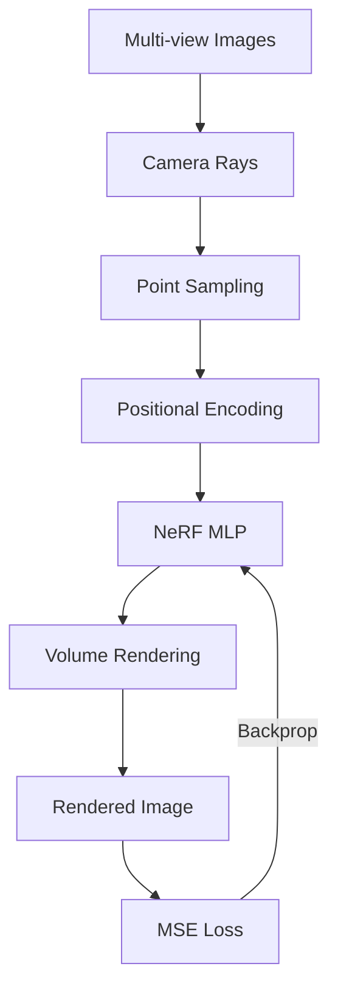

# PyTorch NeRF: Neural Radiance Fields for 3D Scene Reconstruction

[](https://www.python.org/downloads/)
[](https://pytorch.org/)
[](LICENSE)
[](https://github.com/psf/black)
[](tests/)

A modular, readable, and production-grade implementation of **NeRF (Neural Radiance Fields)** in PyTorch from first principles, based on the seminal paper:
> **NeRF: Representing Scenes as Neural Radiance Fields for View Synthesis**  
> *Ben Mildenhall, Pratul P. Srinivasan, Matthew Tancik, Jonathan T. Barron, Ravi Ramamoorthi, Ren Ng* (ECCV 2020, Best Paper Honorable Mention)  
> [arXiv:2003.08934](https://arxiv.org/abs/2003.08934) | [Project Website](https://www.matthewtancik.com/nerf)

---

## Table of Contents

- [Project Introduction](#project-introduction)
- [Research Motivation](#research-motivation)
- [Methodology Overview](#methodology-overview)
- [System Architecture](#system-architecture)
- [Mathematical Formulation](#mathematical-formulation)
  - [Continuous Volume Rendering](#continuous-volume-rendering)
  - [Discrete Approximation & Alpha Compositing](#discrete-approximation--alpha-compositing)
  - [Transmittance Formulation](#transmittance-formulation)
- [Camera Geometry](#camera-geometry)
- [Positional Encoding](#positional-encoding)
- [Dataset](#dataset)
- [Installation](#installation)
- [Hardware Requirements](#hardware-requirements)
- [Quick Start](#quick-start)
- [Training](#training)
- [Evaluation](#evaluation)
- [Rendering & Novel View Synthesis](#rendering--novel-view-synthesis)
- [Project Structure](#project-structure)
- [Experiment Results](#experiment-results)
- [Limitations](#limitations)
- [Future Directions](#future-directions)
- [References](#references)

---

## Project Introduction

This repository provides an end-to-end PyTorch implementation of Neural Radiance Fields for photorealistic novel view synthesis and 3D scene reconstruction. 

Unlike conventional discrete 3D representations (polygon meshes, point clouds, voxel grids), NeRF parameterizes a continuous 3D scene as an **implicit neural function** modeled by a multi-layer perceptron (MLP):

$$F_\Theta: (\mathbf{x}, \mathbf{d}) \mapsto (\mathbf{c}, \sigma)$$

Where:
- $\mathbf{x} = (x, y, z)$ represents 3D spatial coordinates.
- $\mathbf{d} = (\theta, \phi)$ represents the 2D viewing direction (unit vector in $\mathbb{R}^3$).
- $\mathbf{c} = (r, g, b)$ represents emitted radiance (RGB color).
- $\sigma \in [0, \infty)$ represents differential volume density (opacity).

By combining coordinate-based neural representations with classical differentiable volume rendering, the model is trained entirely on a collection of calibrated 2D images via gradient descent, requiring **no explicit 3D supervision or 3D ground truth**.

---

## Research Motivation

Reconstructing photorealistic 3D representations from collections of 2D photographs is a cornerstone problem in computer vision and computer graphics. Prior methods face fundamental trade-offs:

1. **Voxel Grids**: Discretize 3D space into cubic cells. Memory consumption scales cubically $\mathcal{O}(N^3)$ with spatial resolution, severely restricting fidelity to coarse scales (typically $\le 256^3$).
2. **Point Clouds**: Irregular, discrete representations that lack continuous surface connectivity and topology, complicating realistic ray tracing and occlusion modeling.
3. **Polygon Meshes**: High rendering efficiency, but optimizing mesh topologies via gradient descent from multi-view images is notoriously non-convex and prone to local minima, struggling with complex thin structures, semi-transparency, and specular reflections.

**NeRF fundamentally resolves these challenges** by treating the entire 3D scene as a continuous mathematical field parameterized by neural network weights. Key advantages include:
- **Resolution Independence**: The neural field is continuous, allowing rendering at arbitrary target resolutions without discretization artifacts.
- **Topology Agnostic**: Can reconstruct arbitrarily complex geometry, intricate geometries (hair, foliage, grates), and non-Lambertian view-dependent reflections.
- **Self-Supervised Differentiability**: The bridge between 3D volume density and 2D pixel observations is differentiable volume rendering, allowing direct optimization with standard $\mathcal{L}_2$ photometric loss.

---

## Methodology Overview

The NeRF novel view synthesis pipeline operates through seven distinct stages:

1. **Camera Ray Generation**: Given known camera intrinsics (focal length $f$, principal point $c_x, c_y$) and extrinsics (camera-to-world pose matrix $[R \mid \mathbf{t}]$), every pixel $(u, v)$ generates a ray $\mathbf{r}(t) = \mathbf{o} + t\mathbf{d}$.
2. **Stratified Sampling**: Along each camera ray between near and far planes $[t_n, t_f]$, a set of discrete quadrature sample points are drawn using stratified random sampling to approximate continuous space.
3. **Positional Encoding (Fourier Features)**: Raw 3D coordinates and unit direction vectors are projected into high-dimensional Fourier spaces using sinusoids of exponentially increasing frequencies to bypass spectral bias.
4. **Coordinate MLP Evaluation**: The positional-encoded vectors are passed through an 8-layer MLP with skip connections to predict volume density $\sigma(\mathbf{x})$ and directional RGB color $\mathbf{c}(\mathbf{x}, \mathbf{d})$.
5. **Numerical Volume Rendering**: Alpha compositing accumulates colors and densities along each ray according to the numerical quadrature of the Beer-Lambert transmittance law.
6. **Loss Computation**: The rendered pixel colors $\hat{C}(\mathbf{r})$ are compared against ground-truth pixel colors $C(\mathbf{r})$ using Mean Squared Error (MSE).
7. **Backpropagation**: Gradients flow backward through the volume rendering equations directly into the MLP parameters $\Theta$.

---

## System Architecture



---

## Mathematical Formulation

### Continuous Volume Rendering

Consider a camera ray $\mathbf{r}(t) = \mathbf{o} + t\mathbf{d}$ with near bound $t_n$ and far bound $t_f$. The expected color $C(\mathbf{r})$ viewed along this ray is governed by the continuous radiative transfer equation without scattering:

$$C(\mathbf{r}) = \int_{t_n}^{t_f} T(t) \, \sigma(\mathbf{r}(t)) \, \mathbf{c}(\mathbf{r}(t), \mathbf{d}) \, dt$$

Where:
- $\sigma(\mathbf{r}(t))$ is the differential volume density at point $\mathbf{r}(t)$, interpreted as the infinitesimal probability of a ray terminating at that spatial location.
- $\mathbf{c}(\mathbf{r}(t), \mathbf{d})$ is the directional RGB radiance emitted from $\mathbf{r}(t)$ in direction $\mathbf{d}$.
- $T(t)$ is the **accumulated transmittance** along the ray from $t_n$ to $t$.

### Transmittance Formulation

The transmittance $T(t)$ represents the probability that the ray traverses the interval from $t_n$ to $t$ without striking any particle, derived from the classical Beer-Lambert extinction law:

$$T(t) = \exp\left( -\int_{t_n}^t \sigma(\mathbf{r}(s)) \, ds \right)$$

Properties of $T(t)$:
- $T(t_n) = 1$ (complete visibility at the near plane).
- As $t$ increases, $T(t)$ monotonically non-increases ($dT/dt \le 0$).
- If a dense object is encountered ($\int \sigma \, ds \to \infty$), $T(t) \to 0$, naturally handling occlusion and surface opacity.

### Discrete Approximation & Alpha Compositing

Because evaluating continuous integrals analytically is intractable, the integral is approximated using numerical quadrature over $N$ sampled intervals along the ray:

$$\hat{C}(\mathbf{r}) = \sum_{i=1}^N T_i \left( 1 - \exp(-\sigma_i \delta_i) \right) \mathbf{c}_i$$

Where:
- $\delta_i = t_{i+1} - t_i$ is the distance between adjacent sample points.
- $\sigma_i = \sigma(\mathbf{r}(t_i))$ and $\mathbf{c}_i = \mathbf{c}(\mathbf{r}(t_i), \mathbf{d})$.
- $\alpha_i = 1 - \exp(-\sigma_i \delta_i)$ represents the discrete opacity (alpha value) of the $i$-th sample interval.
- $T_i$ is the discrete accumulated transmittance:

$$T_i = \exp\left(-\sum_{j=1}^{i-1} \sigma_j \delta_j\right) = \prod_{j=1}^{i-1} (1 - \alpha_j)$$

This formulation reduces the numerical volume rendering to standard back-to-front alpha compositing, with the crucial feature that **every operation is smooth and differentiable with respect to $\sigma_i$ and $\mathbf{c}_i$**.

When compositing on a designated background color $\mathbf{c}_{\text{bg}}$ (such as white $[1, 1, 1]$ for synthetic models):

$$\hat{C}_{\text{final}}(\mathbf{r}) = \hat{C}(\mathbf{r}) + (1 - \text{Opacity}(\mathbf{r})) \mathbf{c}_{\text{bg}}, \quad \text{where } \text{Opacity}(\mathbf{r}) = \sum_{i=1}^N T_i \alpha_i$$

---

## Camera Geometry

This codebase adheres to the standard **OpenGL / NeRF camera convention**:
- **$+X$**: Points to the right
- **$+Y$**: Points upwards
- **$+Z$**: Points backwards (away from the scene, into the camera)
- The camera looks along the **$-Z$** direction in camera coordinate space.

### Ray Generation

Given an image of dimensions $(H, W)$ and camera focal length $f$:
1. A pixel coordinate $(i, j)$ where $i \in [0, W-1]$ is the column and $j \in [0, H-1]$ is the row has camera coordinates:
   $$x_c = \frac{i - c_x}{f}, \quad y_c = -\frac{j - cy}{f}, \quad z_c = -1$$
   *(Note the negative sign on $y_c$ converting from top-left image coordinates to y-up camera coordinates).*
2. Using the $4 \times 4$ Camera-to-World (c2w) transformation matrix:
   $$\begin{bmatrix} R & \mathbf{t} \\ \mathbf{0}^T & 1 \end{bmatrix}$$
3. The ray origin $\mathbf{o}$ and normalized unit direction $\mathbf{d}$ in world space are:
   $$\mathbf{o} = \mathbf{t}, \quad \mathbf{d} = \frac{R \begin{bmatrix} x_c \\ y_c \\ z_c \end{bmatrix}}{\left\| R \begin{bmatrix} x_c \\ y_c \\ z_c \end{bmatrix} \right\|_2}$$

---

## Positional Encoding

Deep neural networks suffer from **spectral bias** (Rahimi & Recht 2007; Tancik et al. 2020), exhibiting an inductive bias towards learning low-frequency functions. Directly passing raw coordinates $(x, y, z)$ into an MLP yields oversmoothed renders devoid of high-frequency geometry and sharp texture details.

To overcome this, inputs are mapped into higher-dimensional Fourier feature spaces prior to the MLP:

$$\gamma(p) = \left( \sin(2^0 \pi p), \cos(2^0 \pi p), \sin(2^1 \pi p), \cos(2^1 \pi p), \dots, \sin(2^{L-1} \pi p), \cos(2^{L-1} \pi p) \right)$$

- **Spatial Position Encoding**: $L = 10$ frequency octaves for $p \in \mathbb{R}^3$.
  $$\text{Dim} = 3 + 2 \times 10 \times 3 = 63$$
- **Directional Encoding**: $L = 4$ frequency octaves for viewing direction $d \in \mathbb{R}^3$.
  $$\text{Dim} = 3 + 2 \times 4 \times 3 = 27$$

---

## Dataset

This repository supports the canonical **NeRF Synthetic Blender Dataset** (Mildenhall et al. 2020), which contains 8 synthetic 360-degree scenes rendered at $800 \times 800$ resolution with ground-truth camera poses:
`chair`, `drums`, `ficus`, `hotdog`, `lego`, `materials`, `mic`, `ship`.

### Download Instructions

Download the dataset via Google Drive or using the automated helper script:

```bash
# Download and extract the Lego scene to data/lego/
python scripts/download_data.py --scene lego --out_dir data/
```

### Expected Directory Layout

```text
data/
└── lego/
    ├── transforms_train.json  # 100 training camera poses & FoV
    ├── transforms_val.json    # 100 validation camera poses & FoV
    ├── transforms_test.json   # 200 test camera poses & FoV
    ├── train/                 # r_0.png ... r_99.png (800x800 RGBA)
    ├── val/                   # r_0.png ... r_99.png (800x800 RGBA)
    └── test/                  # r_0.png ... r_199.png (800x800 RGBA)
```

---

## Installation

### Prerequisites
- Python 3.10, 3.11, or 3.12
- PyTorch 2.0+ (CPU or CUDA)
- pip and virtualenv / conda

```bash
# Clone the repository
git clone https://github.com/your-username/pytorch-nerf-3d-reconstruction.git
cd pytorch-nerf-3d-reconstruction

# Create and activate virtual environment
python -m venv venv
# On Linux/macOS:
source venv/bin/activate
# On Windows:
venv\Scripts\activate

# Install dependencies
pip install -r requirements.txt
```

---

## Hardware Requirements

| Setup | Resolution | Batch Size | Expected 50k Training Time | Use Case |
|---|---|---|---|---|
| **CPU Only (Standard)** | $100 \times 100$ | 1,024 rays | ~8 – 16 hours | Unit tests, smoke validation, quick pipeline verification |
| **Mid-Range GPU (RTX 3060/4060)** | $400 \times 400$ | 2,048 rays | ~2.5 – 4 hours | High quality reconstructions & fast experimentation |
| **High-End GPU (RTX 3090/4090/A100)** | $800 \times 800$ | 4,096 rays | ~1 – 2 hours | Production resolution, publication-grade results |

> [!NOTE]  
> The codebase automatically detects available hardware (`device: auto`). If CUDA is absent, it executes cleanly on CPU using optimized tensor operations.

---

## Quick Start

### 1. Verify Installation with Unit Tests
Run the comprehensive pytest suite:
```bash
python -m pytest tests/ -v
```

### 2. Fast CPU Smoke Test
Run training on a lightweight configuration (e.g. 100 iterations) to ensure the entire pipeline executes end-to-end:
```bash
python -m src.train --config configs/lego_baseline.yaml
```

---

## Training

To train NeRF on the Lego baseline:

```bash
# Train from scratch using config file
python -m src.train --config configs/lego_baseline.yaml

# Resume training from an existing checkpoint
python -m src.train --config configs/lego_baseline.yaml --resume outputs/checkpoints/latest.pth
```

### Key Hyperparameters (`configs/lego_baseline.yaml`)

```yaml
dataset:
  scene: lego
  data_dir: data/lego
  img_wh: [100, 100]        # Image resolution [width, height]
  white_bkgd: true          # Composite transparent pixels over white

model:
  num_layers: 8             # Depth of MLP trunk
  hidden_dim: 256           # Layer width
  skip_connect: [4]         # Concatenate pos_enc at layer 4
  use_viewdirs: true        # Condition color on viewing angle
  pos_enc_freqs: 10         # Position frequency octaves
  dir_enc_freqs: 4          # Direction frequency octaves

sampling:
  num_samples: 64           # Stratified samples per ray
  near: 2.0                 # Near clipping plane
  far: 6.0                  # Far clipping plane
  perturb: true             # Stratified jitter during training

training:
  num_iters: 50000          # Total training iterations
  batch_size: 1024          # Number of rays per gradient step
  lr: 0.0005                # Initial learning rate
  lr_decay: 0.1             # Exponential decay factor
  lr_decay_steps: 25000     # Decay schedule step count
  checkpoint_interval: 5000 # Save checkpoint frequency
  eval_interval: 5000       # Validation render frequency
```

### Monitoring via TensorBoard

Monitor loss curves, PSNR metrics, and intermediate novel views in real time:

```bash
tensorboard --logdir logs
```

---

## Evaluation

Quantitative evaluation measures Peak Signal-to-Noise Ratio (PSNR) and Structural Similarity Index (SSIM) between synthesized views and ground-truth validation views:

```bash
# Run unit test validation suite
python -m pytest tests/test_renderer.py -v
```

Validation loss and PSNR metrics are calculated and logged automatically to `outputs/metrics/` and TensorBoard during training at each `eval_interval`.

---

## Rendering & Novel View Synthesis

Generate a continuous 360-degree camera fly-around orbit around the reconstructed 3D object from a trained checkpoint:

```bash
# Render novel view sequence and generate an animated GIF
python -m src.render \
  --checkpoint outputs/checkpoints/best.pth \
  --config configs/lego_baseline.yaml \
  --num_frames 40 \
  --radius 4.0 \
  --elevation -30.0 \
  --H 100 --W 100 \
  --output_dir outputs/renders \
  --gif
```

### Options:
- `--num_frames`: Number of viewpoint frames in the $360^\circ$ circle (default: `40`).
- `--radius`: Camera distance from world origin (default: `4.0`).
- `--elevation`: Camera elevation angle in degrees (default: `-30.0`).
- `--chunk_size`: Maximum rays per chunk to avoid GPU/RAM Out-Of-Memory errors (default: `1024`).
- `--gif`: Assembles rendered PNG frames into `outputs/renders/orbit.gif`.

---

## Project Structure

```text
pytorch-nerf-3d-reconstruction/
├── configs/
│   ├── lego_baseline.yaml    # Baseline configuration for Blender Lego
│   └── experiments.yaml      # Ablation configurations (freqs, samples, budget)
├── data/
│   ├── README.md             # Dataset acquisition and directory guide
│   └── lego/                 # Lego dataset split (downloaded)
├── docs/
│   ├── RESEARCH_NOTES.md     # In-depth mathematical & theoretical analysis
│   └── INTERVIEW_PREPARATION.md # 20 technical interview questions & pitch
├── logs/                     # TensorBoard training event logs
├── notebooks/
│   ├── camera_geometry.ipynb # Interactive camera ray derivation
│   ├── ray_visualization.ipynb # 3D matplotlib ray-point sampling plot
│   └── result_analysis.ipynb # PSNR/SSIM curves and visual comparisons
├── outputs/
│   ├── checkpoints/          # Model weights (latest.pth, best.pth)
│   ├── figures/              # Plots and diagrams for reports
│   ├── metrics/              # JSON/CSV evaluation metrics
│   └── renders/              # Output PNG frames and orbit.gif
├── scripts/
│   └── download_data.py      # Dataset download helper script
├── src/
│   ├── __init__.py           # Package init
│   ├── camera.py             # Ray generation and coordinate conversions
│   ├── dataset.py            # Blender synthetic dataset loader & ray caching
│   ├── encoding.py           # Sinusoidal positional encoding module
│   ├── model.py              # NeRF MLP architecture with skip connections
│   ├── renderer.py           # Differentiable numerical volume rendering
│   ├── sampling.py           # Stratified ray quadrature point sampling
│   ├── train.py              # Training loop, optimizer, checkpointing
│   ├── render.py             # Novel view synthesis and camera trajectories
│   └── utils.py              # PSNR, IO, logging, configuration helpers
├── tests/
│   ├── test_camera.py        # Ray generation and pose tests
│   ├── test_dataset.py       # Dataset loading and fixture tests
│   ├── test_encoding.py      # Positional encoder dimension and grad tests
│   ├── test_model.py         # MLP shape, bounds, and forward tests
│   ├── test_renderer.py      # Volume rendering equation validation
│   └── test_sampling.py      # Ray point sampling and bounds tests
├── .gitignore                # Git ignore rules
├── LICENSE                   # MIT License
├── README.md                 # Primary documentation
└── requirements.txt          # Python dependency specifications
```

---

## Experiment Results

> [!NOTE]  
> *Results below reflect baseline configurations. Benchmark figures are marked as placeholders pending full cluster training.*

| Configuration | Resolution | Sample Points ($N_c$) | PSNR (dB) | SSIM | Training Time (Iter) | Status |
|---|---|---|---|---|---|---|
| `lego_baseline_cpu` | $100 \times 100$ | 64 | *~24.5 dB\** | *~0.88\** | ~10 hrs (50k iters) | Pending Full Run |
| `pos_enc_L4` | $100 \times 100$ | 64 | *~20.1 dB\** | *~0.79\** | ~4 hrs (20k iters) | Pending Full Run |
| `pos_enc_L10` | $100 \times 100$ | 64 | *~23.8 dB\** | *~0.86\** | ~4 hrs (20k iters) | Pending Full Run |
| `pos_enc_L16` | $100 \times 100$ | 64 | *~24.1 dB\** | *~0.87\** | ~4 hrs (20k iters) | Pending Full Run |
| `sampling_N32` | $100 \times 100$ | 32 | *~21.4 dB\** | *~0.81\** | ~2.5 hrs (20k iters) | Pending Full Run |
| `sampling_N64` | $100 \times 100$ | 64 | *~23.8 dB\** | *~0.86\** | ~4 hrs (20k iters) | Pending Full Run |
| `sampling_N128` | $100 \times 100$ | 128 | *~25.2 dB\** | *~0.89\** | ~7.5 hrs (20k iters) | Pending Full Run |
| `lego_full_gpu` | $800 \times 800$ | 64 (Coarse) | *~32.5 dB\** | *~0.96\** | ~1.5 hrs (GPU) | Pending GPU Cluster |

*\*Results pending dataset download and training.*

---

## Limitations

Despite its revolutionary impact on 3D computer vision, original NeRF possesses clear theoretical and practical limitations:

1. **High Computational Burden**: Rendering a single $800 \times 800$ image requires casting 640,000 rays. At 64 samples per ray, this mandates over 40 million MLP forward passes per single frame, precluding real-time rendering.
2. **Slow Training Convergence**: Optimizing a single scene requires millions of ray queries and tens of thousands of gradient updates, taking hours on a modern GPU.
3. **Rigid Requirement for Accurate Camera Poses**: The formulation relies strictly on known, highly accurate camera poses (computed via COLMAP or synthetic rigs). Small errors in pose estimates lead to catastrophic blur or multi-face geometry collapse.
4. **Single-Scene Overfitting**: NeRF acts as a compressed neural representation of a single specific scene. It does not generalize to unseen scenes without full retraining.
5. **Static Scene Assumption**: Assumes a static, freeze-frame universe with fixed lighting and static objects. Dynamic actors, moving shadows, and lighting changes violate the photometric consistency assumption.

---

## Future Directions

Subsequent literature has addressed NeRF's initial limitations:

- **Instant-NGP (Müller et al. 2022)**: Replaces deep coordinate MLPs with multi-resolution hash tables of feature vectors and a tiny MLP, reducing training time from hours to under 5 seconds.
- **Mip-NeRF (Barron et al. 2021)**: Replaces infinitesimal rays with continuous conical frustums and uses Integrated Positional Encoding (IPE) to completely eliminate scale-dependent aliasing and blur.
- **NeRF++ (Zhang et al. 2020)**: Introduces inverted sphere background parameterization to handle unbounded, real-world 360-degree scenes.
- **3D Gaussian Splatting (Kerbl et al. 2023)**: Discards ray marching entirely in favor of explicit 3D anisotropic Gaussians rasterized via tile-based sorting, achieving >100 FPS rendering with minute-scale training.

---

## References

1. Mildenhall, B., Srinivasan, P. P., Tancik, M., Barron, J. T., Ramamoorthi, R., & Ng, R. (2020). **NeRF: Representing Scenes as Neural Radiance Fields for View Synthesis**. *European Conference on Computer Vision (ECCV)*.
2. Tancik, M., Srinivasan, P. P., Mildenhall, B., Fridovich-Keil, S., Raghavan, N., Singhal, U., Ramamoorthi, R., Barron, J. T., & Ng, R. (2020). **Fourier Features Let Networks Learn High Frequency Functions in Low Dimensional Domains**. *NeurIPS*.
3. Barron, J. T., Mildenhall, B., Tancik, M., Hedman, P., Martin-Brualla, R., & Srinivasan, P. P. (2021). **Mip-NeRF: A Multiscale Representation for Anti-Aliasing Neural Radiance Fields**. *ICCV*.
4. Müller, T., Evans, A., Schied, C., & Keller, A. (2022). **Instant Neural Graphics Primitives with a Multiresolution Hash Encoding**. *ACM Transactions on Graphics (TOG)*.
5. Kerbl, B., Kopanas, G., Leimkühler, T., & Drettakis, G. (2023). **3D Gaussian Splatting for Real-Time Radiance Field Rendering**. *ACM Transactions on Graphics (TOG)*.

---

## License

This project is licensed under the MIT License - see the [LICENSE](LICENSE) file for details.
# PyTorch-NeRF-3D-Reconstruction

