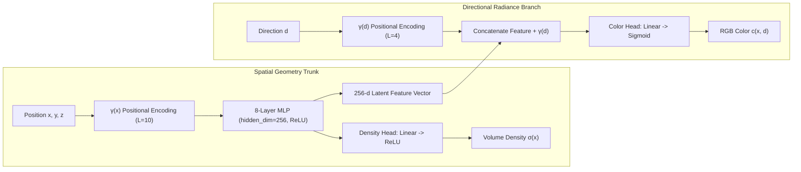

# Theoretical Foundations & Research Notes: Neural Radiance Fields (NeRF)

---

## Abstract & Document Overview

This document provides a comprehensive, mathematically rigorous analysis of **Neural Radiance Fields (NeRF)** and neural implicit representations for 3D computer vision. It is compiled to serve as an in-depth theoretical companion to the codebase, detailing foundational graphics principles, camera calibration geometry, radiative transfer physics, harmonic analysis in deep networks, and comparative analyses with modern frontiers such as 3D Gaussian Splatting.

---

## 1. Why NeRF is Useful: Implicit vs. Explicit Scene Representations

In classical computer graphics and 3D computer vision, scenes are represented **explicitly**. While intuitive, explicit structures impose severe computational and geometrical bottlenecks:

### 1.1 Taxonomy of 3D Representations

| Representation Type | Structure | Advantages | Fundamental Bottlenecks |
|---|---|---|---|
| **Voxel Grids** | Dense 3D array of occupancy or color: $\mathbb{R}^{W \times H \times D}$ | Trivial indexing, straightforward GPU ray marching | $\mathcal{O}(N^3)$ cubic scaling in memory; $512^3$ voxels require gigabytes for low detail |
| **Point Clouds** | Unordered set of coordinates $\{ \mathbf{p}_i \in \mathbb{R}^3 \}$ | Compact for sparse surfaces, straightforward acquisition via LiDAR | Lacks continuous surface topology, normal orientation ambiguity, difficult occlusion reasoning |
| **Polygon Meshes** | Vertices $V$, Edges $E$, Faces $F$ | Highly optimized hardware rasterization, standard in gaming/VFX | Fixed topology; non-differentiable edge boundaries; fails on semi-transparent or diffuse phenomena (smoke, hair) |
| **Implicit Neural Fields (NeRF)** | Continuous function $F_\Theta: \mathbb{R}^3 \times \mathbb{S}^2 \to \mathbb{R}^3 \times \mathbb{R}^+$ | **Continuous, resolution-free, compact memory footprint, topology-agnostic, fully differentiable** | Query latency: requires evaluating a deep MLP millions of times per frame |

### 1.2 The Paradigm Shift of Continuous Coordinate Representations

NeRF treats the scene not as a geometric boundary, but as a **continuous optical field**. Because the scene geometry and radiometric appearance are encoded inside the continuous weights of a Multi-Layer Perceptron (MLP), the representation:
1. **Bypasses Discretization Artifacts**: A coordinate $(x, y, z)$ can be queried at arbitrary sub-voxel precision.
2. **Naturally Handles Semi-Transparency & Volume Scattering**: Solid surfaces, clouds of dust, glassware, and fur are naturally unified under continuous volume density $\sigma$.
3. **Optimizes via Standard Backpropagation**: Traditional mesh fitting requires resolving discrete topological transitions (e.g. splitting faces). In contrast, NeRF optimizes smoothly over continuous density fields using standard stochastic gradient descent.

---

## 2. How Neural Scene Representations Work

A Neural Radiance Field models a 3D scene as a 5D vector-valued function:

$$F_\Theta: (\mathbf{x}, \mathbf{d}) \mapsto (\mathbf{c}, \sigma)$$

Where:
- $\mathbf{x} = (x, y, z) \in \mathbb{R}^3$: The 3D spatial coordinate within the scene bounding box.
- $\mathbf{d} = (\theta, \phi) \in \mathbb{S}^2$: The viewing direction expressed as a 3D Cartesian unit vector $\|\mathbf{d}\|_2 = 1$.
- $\mathbf{c} = (r, g, b) \in [0, 1]^3$: The emitted RGB radiance along direction $\mathbf{d}$ from location $\mathbf{x}$.
- $\sigma \in [0, \infty)$: The differential volume density at $\mathbf{x}$.



### 2.1 The Principle of View-Dependent Radiance vs. View-Invariant Geometry

A critical architectural insight of NeRF is the physical constraint enforced between geometry and appearance:
1. **Geometry must be view-invariant**: The presence of physical matter at point $\mathbf{x}$ cannot depend on the angle from which a camera observes it. Therefore, volume density $\sigma(\mathbf{x})$ is predicted **strictly** from the spatial coordinate $\mathbf{x}$ alone:
   $$\sigma = \text{ReLU}(W_\sigma \cdot h(\mathbf{x}) + b_\sigma)$$
2. **Appearance is view-dependent**: Due to non-Lambertian effects (specular highlights, Fresnel reflections, metallic sheen), emitted radiance varies with observation angle. Thus, the directional vector $\mathbf{d}$ is injected only at the final color layer, conditioned on both the spatial geometry latent feature $h(\mathbf{x})$ and the encoded direction:
   $$\mathbf{c} = \text{Sigmoid}(W_c \cdot [h(\mathbf{x}), \gamma(\mathbf{d})] + b_c)$$

This architectural decomposition prevents the network from "cheating" by hallucinating floating geometry whose shape changes per viewpoint, forcing the MLP to discover consistent, multi-view coherent 3D geometry.

---

## 3. Why Camera Poses are Required (Coordinate Frame Alignment)

NeRF solves an **inverse rendering problem**: given 2D observations $I_k$, find the 3D field $F_\Theta$ that reproduces all images under known projection operators $\mathcal{P}_k$:

$$\hat{I}_k = \mathcal{P}_k(F_\Theta)$$

### 3.1 The Multiview Geometric Constraint
For volume rendering to accumulate colors across multiple viewpoints, rays from different cameras that observe the same physical 3D point $\mathbf{P} \in \mathbb{R}^3$ must intersect at the identical spatial coordinate in the network's canonical reference frame:

$$\mathbf{p}_{\text{cam}, k} = R_k \mathbf{P} + \mathbf{t}_k \iff \mathbf{P} = R_k^T (\mathbf{p}_{\text{cam}, k} - \mathbf{t}_k)$$

If the extrinsic camera poses $[R_k \mid \mathbf{t}_k]$ contain errors:
- Rays observing the same physical surface feature fail to intersect in 3D space.
- The network attempts to minimize photometric loss across contradictory camera views by creating multiple blurry, semi-transparent ghost copies of the object at different depths ("cloudy floaters").
- In severe misalignments, geometric collapse occurs, and the model degrades into a flat, view-dependent billboard plastered near the near plane.

In standard workflows, camera poses are computed upstream using **Structure-from-Motion (SfM)** pipelines such as **COLMAP**, which detects local scale-invariant feature points (e.g. SIFT), matches them across pairs, and performs global non-linear Bundle Adjustment to solve jointly for 3D sparse points and extrinsic camera matrices.

---

## 4. Ray Generation from Camera Intrinsics and Extrinsics

Ray generation establishes the mapping from discrete 2D sensor pixels $(u, v)$ to continuous 3D world rays $\mathbf{r}(t) = \mathbf{o} + t\mathbf{d}$.

```
Pixel Grid (u, v)
      │
      ▼  Pinhole Intrinsics (f, cx, cy)
Camera Frame Direction: d_cam = [(u - cx)/f, -(v - cy)/f, -1]^T
      │
      ▼  Extrinsics (c2w = [R | t])
World Frame Origin:    o = t
World Frame Direction: d_world = (R · d_cam) / ||R · d_cam||
```

### 4.1 Pinhole Camera Model
Let the image plane have width $W$ and height $H$. Under a pinhole model with focal length $f$ and principal point $(c_x, c_y) = (W/2, H/2)$, the camera intrinsic matrix $K$ is:

$$K = \begin{bmatrix} f & 0 & c_x \\ 0 & f & c_y \\ 0 & 0 & 1 \end{bmatrix}$$

For synthetic datasets where horizontal field-of-view $\theta_{\text{fov}}$ is given:

$$f = \frac{W}{2 \tan\left(\frac{\theta_{\text{fov}}}{2}\right)}$$

### 4.2 Pixel to Camera Coordinates
Under the OpenGL coordinate convention (where $+X$ is right, $+Y$ is up, and looking down the $-Z$ axis):
- Column coordinate $i \in [0, W-1]$ maps to $x_c = \frac{i - c_x}{f}$
- Row coordinate $j \in [0, H-1]$ maps to $y_c = -\frac{j - c_y}{f}$ (negated because pixel row indices increase downwards)
- Depth direction $z_c = -1$

The unnormalized camera-space ray direction is:

$$\mathbf{d}_{\text{cam}} = \begin{bmatrix} (i - c_x)/f \\ -(j - c_y)/f \\ -1 \end{bmatrix}$$

### 4.3 Camera-to-World (c2w) Transformation
A $4 \times 4$ camera-to-world extrinsic matrix $T_{\text{c2w}}$ is structured as:

$$T_{\text{c2w}} = \begin{bmatrix} R_{3 \times 3} & \mathbf{t}_{3 \times 1} \\ \mathbf{0}_{1 \times 3} & 1 \end{bmatrix}$$

- The ray origin $\mathbf{o}$ in world coordinates is the translation vector of the camera center:
  $$\mathbf{o} = \mathbf{t}$$
- The ray direction vector $\mathbf{d}$ in world coordinates is obtained by rotating $\mathbf{d}_{\text{cam}}$ and normalizing to unit length:
  $$\mathbf{d} = \frac{R \mathbf{d}_{\text{cam}}}{\|R \mathbf{d}_{\text{cam}}\|_2}$$

---

## 5. Why Positional Encoding is Necessary: Spectral Bias & Frequency Gap Theory

A central discovery in NeRF is that standard Multi-Layer Perceptrons parameterized as:

$$f_\theta(\mathbf{x}) = W_n \phi(W_{n-1} \dots \phi(W_1 \mathbf{x} + b_1) \dots) + b_n$$

are fundamentally incapable of learning high-frequency geometrical details and fine surface textures when trained directly on raw spatial coordinates $\mathbf{x} \in \mathbb{R}^3$.

### 5.1 Spectral Bias in Neural Networks
As proven by Rahimi & Recht (2007) and analyzed in the context of the **Neural Tangent Kernel (NTK)** by Tancik et al. (NeurIPS 2020):
1. In the infinite-width limit, training an MLP via gradient descent is equivalent to kernel regression with the NTK:
   $$\Theta(\mathbf{x}_i, \mathbf{x}_j) = \mathbb{E}_{\theta} \left[ \left\langle \frac{\partial f(\mathbf{x}_i; \theta)}{\partial \theta}, \frac{\partial f(\mathbf{x}_j; \theta)}{\partial \theta} \right\rangle \right]$$
2. For standard coordinate MLPs with ReLU activations, the eigen-decomposition of the NTK reveals that its eigenvalues decay exponentially fast with frequency:
   $$\lambda_k \propto k^{-d}$$
3. Consequently, the network learns the lowest Fourier components of the target signal almost immediately, while high-frequency components converge at an infinitesimally slow rate. This phenomenon is known as **spectral bias**.

```
High Eigenvalues (Low Frequencies):   Learned in iters 1 - 500  --> Produces blurry silhouettes
Low Eigenvalues (High Frequencies):   Learned in iters 10^5+    --> Never resolves sharp edges!
```

### 5.2 Fourier Feature Mapping
NeRF overcomes spectral bias by mapping low-dimensional coordinates $\mathbf{p} \in \mathbb{R}^D$ into a higher-dimensional hypersphere using a deterministic sinusoidal projection:

$$\gamma(p) = \left[ \sin(2^0 \pi p), \cos(2^0 \pi p), \sin(2^1 \pi p), \cos(2^1 \pi p), \dots, \sin(2^{L-1} \pi p), \cos(2^{L-1} \pi p) \right]^T$$

By mapping coordinates through harmonic functions with dyadic (power-of-two) octave spacing:
- The input dimension expands from $D$ to $2LD$ (or $D + 2LD$ when including the identity coordinate).
- The Fourier feature mapping shifts the NTK spectrum, shifting the eigenvalues corresponding to high spatial frequencies upwards.
- This allows gradient descent to rapidly fit sharp geometrical boundaries, high-frequency specular transitions, and fine surface textures.

---

## 6. What Volume Density Represents Physically

In classical radiative transfer (Chandrasekhar, 1960; Max, 1995), light propagates through participating media consisting of microscopic particles:

$$\frac{dI(t)}{dt} = -\sigma(\mathbf{r}(t)) I(t) + \sigma(\mathbf{r}(t)) c(\mathbf{r}(t), \mathbf{d})$$

### 6.1 Physical Interpretation of $\sigma$
1. **Differential Extinction Coefficient**: The volume density $\sigma(\mathbf{x}) \ge 0$ represents the differential probability per unit length that a photon traveling through $\mathbf{x}$ will collide with a microscopic particle and either be absorbed or scattered out of the ray path.
2. **Probability of Ray Termination**: The probability that a ray terminates in the differential interval $[t, t + dt]$ is given by:
   $$dP(t) = T(t) \cdot \sigma(\mathbf{r}(t)) \, dt$$
3. **Hard Surfaces vs. Volumetric Fog**:
   - For an idealized solid surface at depth $t_0$, $\sigma(t) \to \infty$ for $t \ge t_0$. In this limit, the rendering equation collapses exactly to surface rendering: $C(\mathbf{r}) = c(\mathbf{r}(t_0), \mathbf{d})$.
   - For semi-transparent materials (clouds, stained glass), $\sigma$ takes intermediate positive values.
   - For vacuum (empty free space), $\sigma = 0$.

Because negative densities are physically impossible (photons cannot be created out of negative particle absorption), $\sigma$ is enforced to be strictly non-negative via a **ReLU** or **softplus** activation at the output of the density head.

---

## 7. How Transmittance Works: The Beer-Lambert Law

The accumulated transmittance $T(t)$ quantifies the fraction of radiance that passes through the participating medium from near boundary $t_n$ to depth $t$ without being extinguished.

### 7.1 Mathematical Derivation from First Principles
Consider an incoming beam of radiance $I(t)$ traversing an infinitesimal slab of thickness $dt$. The fraction of radiance lost to extinction is proportional to the density $\sigma(t)$ and the slab width $dt$:

$$\frac{dI(t)}{I(t)} = -\sigma(t) \, dt$$

Integrating this separable differential equation from $t_n$ to $t$:

$$\int_{I(t_n)}^{I(t)} \frac{dI'}{I'} = -\int_{t_n}^t \sigma(s) \, ds$$

$$\ln\left(\frac{I(t)}{I(t_n)}\right) = -\int_{t_n}^t \sigma(s) \, ds$$

$$T(t) = \frac{I(t)}{I(t_n)} = \exp\left( -\int_{t_n}^t \sigma(\mathbf{r}(s)) \, ds \right)$$

This is the continuous form of the **Beer-Lambert Law** of absorption.

### 7.2 Monotonicity and Occlusion Reasoning
Because $\sigma(s) \ge 0$ for all $s$:
- The integral $\int_{t_n}^t \sigma(s) ds$ is monotonically non-decreasing with $t$.
- Therefore, $T(t)$ is strictly bounded in $[0, 1]$ and monotonically non-increasing.
- Once a ray hits an opaque object, $\int \sigma ds$ becomes large, driving $T(t) \approx 0$.
- Any subsequent color $c(t')$ for $t' > t$ is multiplied by $T(t') \approx 0$, ensuring that occluded geometry behind solid objects receives zero contribution to the pixel color and receives zero backpropagated gradient.

---

## 8. Why Differentiable Volume Rendering Matters

The core brilliance of NeRF lies in formulating the 3D-to-2D image synthesis operator as a **smooth, continuous, fully differentiable integral**.

```
Ground Truth Image I(r)
          │
          ▼  Photometric Loss: L = ||C_pred(r) - I(r)||^2
   Rendered Color C_pred(r)
          │
          ▼  ∂L / ∂C_pred
Volume Rendering Equation:  C_pred = Σ T_i · α_i · c_i
          │
    ┌─────┴─────────────────────────┐
    ▼                               ▼
∂L / ∂c_i = 2(C_pred - I) · w_i     ∂L / ∂σ_i = Σ_k (∂L / ∂C_pred) · (∂C_pred / ∂w_k) · (∂w_k / ∂σ_i)
    │                               │
    ▼                               ▼
Color Head MLP Weights           Density Trunk MLP Weights
```

### 8.1 Comparison with Mesh Rasterization
In traditional surface rendering:
- A triangle either covers a pixel or it does not (Heaviside step function $H(x)$).
- The derivative of a step function at the triangle edge is a Dirac delta $\delta(x)$, which is zero almost everywhere and infinite at the boundary.
- Consequently, optimizing polygon mesh geometry via gradient descent from multi-view images requires complex differentiable approximations (e.g., SoftRas, PyTorch3D) that struggle with topological changes.

### 8.2 Smooth Gradient Flow in NeRF
In NeRF's numerical volume rendering:

$$\hat{C}(\mathbf{r}) = \sum_{i=1}^N w_i \mathbf{c}_i, \quad \text{where } w_i = T_i (1 - \exp(-\sigma_i \delta_i))$$

- The rendered color $\hat{C}$ is a continuous, smooth function of every sample's density $\sigma_i$ and color $\mathbf{c}_i$.
- **Gradients with respect to color**:
  $$\frac{\partial \mathcal{L}}{\partial \mathbf{c}_i} = 2 (\hat{C} - C) \cdot w_i$$
  Color updates are scaled by the sample's visibility weight $w_i$.
- **Gradients with respect to density**:
  $$\frac{\partial \mathcal{L}}{\partial \sigma_i} = 2 (\hat{C} - C) \cdot \left[ T_i \delta_i \exp(-\sigma_i \delta_i) \mathbf{c}_i - \delta_i \sum_{k=i+1}^N w_k \mathbf{c}_k \right]$$
  This equation provides an intuitive physical push-pull mechanism:
  - The first term **increases** density $\sigma_i$ if the sample's color $\mathbf{c}_i$ matches the target pixel color.
  - The second term **decreases** density $\sigma_i$ if downstream samples ($k > i$) already explain the target color better.

---

## 9. Computational Complexity & The Sampling Bottleneck

NeRF is notoriously compute-intensive during both training and inference. Understanding the exact arithmetic operation count explains why training takes hours:

### 9.1 Arithmetic Query Analysis
Consider synthesizing a single $800 \times 800$ image:
- Number of camera rays: $R = 800 \times 800 = 640,000\text{ rays}$.
- Quadrature samples per ray: $N_c = 64$ coarse samples $+ N_f = 128$ fine samples $= 192\text{ samples/ray}$.
- Total 3D points queried per frame:
  $$P_{\text{frame}} = 640,000 \times 192 = 122,880,000 \text{ points (122.8 million!)}$$

For each 3D point:
- The MLP has 8 layers of width 256.
- Matrix multiplications per forward pass:
  $$\text{FLOPs} \approx 8 \times (256 \times 256) \times 2 \approx 1,048,576 \text{ FLOPs/point}$$
- Total FLOPs for **one single frame**:
  $$\text{FLOPs}_{\text{frame}} \approx 1.228 \times 10^8 \times 1.05 \times 10^6 \approx 1.29 \times 10^{14} \text{ FLOPs (129 TeraFLOPs!)}$$

On an NVIDIA RTX 3080 (~30 TFLOPs FP32), rendering a single full-resolution frame takes:
$$\frac{129 \text{ TFLOPs}}{30 \text{ TFLOPs/s}} \approx 4.3 \text{ seconds per image}$$
This explains why vanilla NeRF cannot achieve real-time frame rates without caching, sparse grids, or hardware-accelerated data structures.

---

## 10. Quantitative Evaluation: PSNR and SSIM

Image quality in novel view synthesis is evaluated using two primary objective metrics:

### 10.1 Peak Signal-to-Noise Ratio (PSNR)
PSNR is derived directly from Mean Squared Error (MSE) between the ground-truth image $I$ and synthesized image $\hat{I}$ normalized to $[0, 1]$:

$$\text{MSE} = \frac{1}{3HW} \sum_{c=1}^3 \sum_{y=1}^H \sum_{x=1}^W (I(x, y, c) - \hat{I}(x, y, c))^2$$

$$\text{PSNR} = 10 \cdot \log_{10}\left( \frac{\text{MAX}_I^2}{\text{MSE}} \right) = -10 \cdot \log_{10}(\text{MSE}) \quad (\text{for } \text{MAX}_I = 1)$$

- **Interpretation**: Logarithmic scale measured in decibels (dB).
- **Rule of Thumb**:
  - $< 20\text{ dB}$: Severely blurry or geometrically distorted.
  - $20 - 25\text{ dB}$: Recognizable coarse geometry, blurry textures.
  - $25 - 30\text{ dB}$: Good quality, sharp silhouettes, slight texture smoothing.
  - $> 30\text{ dB}$: High-fidelity, photorealistic reconstruction.
  - $> 35\text{ dB}$: Indistinguishable from ground truth.

### 10.2 Structural Similarity Index (SSIM)
While PSNR measures absolute pixel-wise numerical error, it correlates poorly with human perceptual judgment of blurriness or texture preservation (a slightly shifted image has terrible MSE despite looking identical).

SSIM (Wang et al. 2004) computes localized structural similarity over sliding Gaussian windows $x, y$:

$$\text{SSIM}(x, y) = \frac{(2\mu_x \mu_y + C_1)(2\sigma_{xy} + C_2)}{(\mu_x^2 + \mu_y^2 + C_1)(\sigma_x^2 + \sigma_y^2 + C_2)}$$

Decomposed into three orthogonal components:
1. **Luminance comparison**: $l(x, y) = \frac{2\mu_x \mu_y + C_1}{\mu_x^2 + \mu_y^2 + C_1}$
2. **Contrast comparison**: $c(x, y) = \frac{2\sigma_x \sigma_y + C_2}{\sigma_x^2 + \sigma_y^2 + C_2}$
3. **Structure correlation**: $s(x, y) = \frac{\sigma_{xy} + C_3}{\sigma_x \sigma_y + C_3}$

SSIM values range from $-1$ to $+1$, where $+1$ indicates identical perceptual structure. NeRF models typically achieve SSIM scores $> 0.90$ on synthetic benchmarks.

---

## 11. Limitations of Original NeRF

1. **Slow Training and Inference**: Optimizing one scene requires $100\text{k} - 300\text{k}$ iterations ($1 - 2$ days on early hardware); rendering is limited to $\approx 0.1\text{ FPS}$.
2. **Pre-computed Poses Mandate**: Cannot train on in-the-wild video without accurate SfM pose preprocessing.
3. **No Cross-Scene Generalization**: The network weights overfit to a single scene coordinate system. Reconstructing a new object requires retraining from scratch.
4. **Static World Assumption**: Fails when dynamic actors, fluctuating illumination, or moving shadows are present.
5. **Bounded Scene Assumption**: Standard positional encoding assumes scene geometry is confined within a normalized bounding cube $[-1, 1]^3$. Backgrounds in unbounded outdoor scenes suffer from severe aliasing or collapse.

---

## 12. NeRF vs. 3D Gaussian Splatting (3DGS)

In 2023, 3D Gaussian Splatting (Kerbl et al.) introduced a major alternative paradigm to implicit neural fields:

| Dimension | Neural Radiance Fields (NeRF) | 3D Gaussian Splatting (3DGS) |
|---|---|---|
| **Representation Type** | **Implicit continuous field**: MLP weights $F_\Theta(\mathbf{x}, \mathbf{d})$ | **Explicit primitive collection**: Millions of 3D anisotropic Gaussians |
| **Parameters** | Fixed network weights ($\sim 5\text{ MB}$) | Position $\mu$, 3D Covariance $\Sigma$ (scale + quaternion), Opacity $\alpha$, Spherical Harmonics ($50 - 500\text{ MB}$) |
| **Rendering Primitive** | Ray marching with numerical quadrature integration | GPU tile-based sorting and alpha splatting (rasterization) |
| **Training Speed** | Hours to days (dense MLP queries) | **Minutes** ($5 - 15$ mins on single GPU) |
| **Inference Frame Rate** | $< 1\text{ FPS}$ (vanilla) to $15\text{ FPS}$ (Instant-NGP) | **$> 100 - 200\text{ FPS}$** (real-time native 1080p) |
| **Memory Footprint** | Extremely compact ($\sim 5\text{ MB}$ weights file) | Substantial disk and VRAM storage for millions of Gaussians |
| **Geometric Editing** | Difficult (continuous global MLP weights) | Intuitive (individual Gaussians can be transformed, deleted, rigged) |


---

## 13. Future Research Directions & Modern Extensions

1. **Instant Neural Graphics Primitives (Instant-NGP)**: Replaces deep 8-layer MLPs with multi-resolution hash tables storing interpolated feature vectors, followed by a tiny 2-layer MLP. Achieves training in seconds and near-real-time rendering.
2. **Mip-NeRF & Anti-Aliasing**: Formulates queries as 3D conical frustums instead of infinitesimal rays. Samples are represented as multivariate Gaussians integrated with Integrated Positional Encodings (IPE), preventing blurriness when zooming in and aliasing when zooming out.
3. **Unbounded Scenes (NeRF++ & Mip-NeRF 360)**: Parameterizes foreground objects inside an inner unit sphere and maps unbounded background environments to an outer inverted sphere via contracted coordinates.
4. **Generalizable NeRF (pixelNeRF, MVSNeRF)**: Conditions neural fields on multi-view 2D CNN image feature maps, allowing novel view synthesis for completely unseen scenes with zero per-scene optimization.
5. **Dynamic Deformable Fields (D-NeRF, Nerfies)**: Decomposes dynamic scenes into a canonical static field and a continuous temporal displacement field $\Delta \mathbf{x} = \Psi(\mathbf{x}, t)$, enabling 4D spatio-temporal reconstruction from monocular phone captures.
